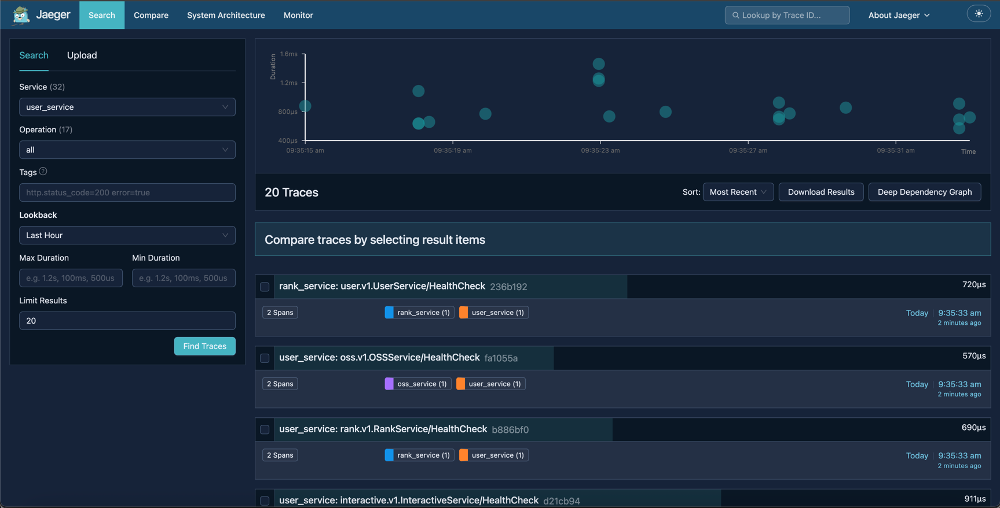
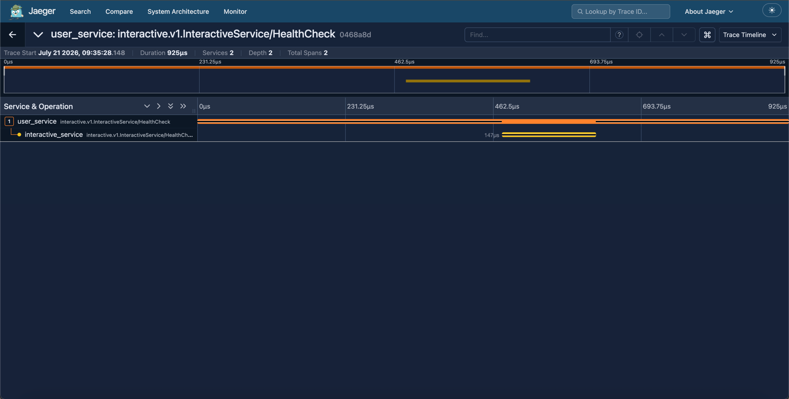
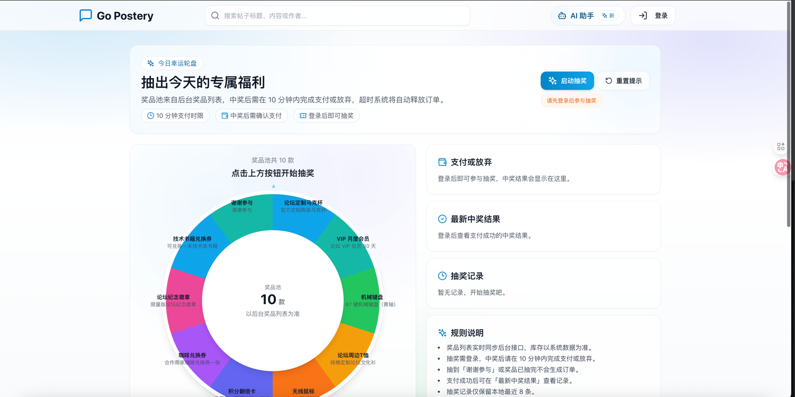

# go-postery

  

  <b>📖 Go-Postery —— 微服务论坛与 AI 面试 Agent 平台</b>

## 简介

- 用 Go 实现的微服务论坛与 AI 面试 Agent 平台
- 后端代码量：41000 + 行
- 当前分支为微服务

## 项目介绍
基于 Go 构建微服务论坛，覆盖用户认证、内容发布、搜索、评论互动、私信、热榜与抽奖，并集成多 Agent 模拟面试系统

技术栈：Gin + GORM + Eino + MySQL + Redis + Milvus + etcd + Kafka + RabbitMQ + RocketMQ + gRPC + Prometheus + Grafana + Docker + Jaeger
- 项目功能：短信 / 邮箱验证码注册登录、修改资料、上传头像、帖子发布修改、标签、搜索、评论关注、私信、榜单、抽奖及 AI 面试助手等功能；
- 基础设施：采用雪花算法生成分布式 ID，建立 etcd 远程配置中心读取动态配置，利用信号机制的监听实现优雅关机；
- 热门榜单：设计简化版的 Reddit 论坛算法，通过 Redis ZSet 实现用户和帖子热榜功能，并通过 Crontab 定时扫表进行榜单计算；
- 帖子搜索：利用 sego 对搜索内容进行分词，结合自研手写的 Go-Searchery 分布式类 Elasticsearch 搜索引擎实现论坛帖子搜索功能；
- IM 即时通讯：持久化消息利用 RabbitMQ Fan-Out 模式通过 WebSocket 双向投递推送到目标窗口，同时加载历史消息，简单实现已读和未读消息数功能；
- 部署与可观测：使用 Docker + Nginx 前后端分离部署；通过 Prometheus + Grafana 监控接口 QPS 与平均耗时，使用 Jaeger 跟踪跨服务调用链路；
- 服务治理：基于 gRPC + etcd 实现服务注册发现、租约续期；实现健康检查、负载均衡、重试、熔断与降级，通过 Redis + Lua 实现滑动窗口限流；
- 身份认证：采用 JWT Access Token 与随机 Refresh Token 双令牌机制，通过 HttpOnly Cookie 和 Redis 管理刷新凭证及黑名单；
- 文件存储访问：通过阿里云 OSS，服务端签名在前端直传，并对上传回调进行落库处理，返回预签名 URL 进行前端显示，避免公开访问 Bucket；
- 消息可靠性：通过 Kafka + Outbox 异步投递点赞、评论事件削峰，具有抢占、重试、退避设计，保证了至少一次投递，并进行消费者幂等处理，减少消息重复消费，消费后手动 ACK 减少消息丢失；设计了记录帖子 ID + 主评论 ID 的评论树结构，实现二级子评论回复功能；
- 高并发秒杀抽奖：Redis 预热库存，验证用户抽奖资格，设计了根据实时库存计算概率的抽奖算法并通过 Redis + Lua 实现库存原子扣减，结合 RocketMQ 的延迟消息完成订单超时回收和库存回补，本地单机测试抽奖接口 QPS 2800+，平均接口耗时 70+ ms；
- AI Agent：编排 7 个 Agent，实现模拟面试系统，设计向量 + BM25 双路召回架构，通过 RRF（k = 60）融合排序 + LLMRerank 重排序，具备动态难度调节、记忆用户画像与 Skill 多轮交互能力，覆盖 JD 分析、简历匹配、智能出题、实时面试到评估报告的完整流程；
  - 构建 RAG 离线评估流水线，统计 Recall@K、MRR 及 topic 分组效果，通过 A/B 对比将 TopK 从 10 调至 20，使 Recall@10 提升 8.24%；

## 待处理的问题

- 设计高性能分布式 Websocket 网关
- 对每个 email、phone 设置单日验证码上限防刷
- 注册 Session 前进行 DB 唯一约束避免打爆 RabbitMQ
- 密码校验 identifier
- 找回密码功能
- 关注用户发表的文章
- 私信： 对私信前置条件进行限制（当前为任意皆可私信）、群聊
- 抽奖： 中间状态保持
- 管理员后台
- 回补临时库存时，永久 TTL 的问题

## 项目演示

|                              |                      |
|:------------------------------------------------------------------:|--------------------------------------------------------------------------------|
|                    |                      |
|          |  |
|          |                      |
|                                       |                                                   |
|                              |                                                     |

## 项目难点

### 1. 多 Agent 面试的状态编排与会话恢复

- 面试需要跨请求衔接出题、回答、评分与追问，并根据答题表现调整后续题目。基于 Eino Graph 拆分准备、面试与评估流程，通过显式 Phase 校验状态转移、控制分支，衔接 JD 分析、简历匹配、题目规划、实时面试、评估与复习计划。
- 将会话状态、题目调度器快照与已问题目集合持久化到 MySQL，后续请求加载快照恢复进度；按连续答对 / 答错情况调节难度，结合用户画像中的历史薄弱点进行针对性出题。

### 2. RAG 双路召回、用户隔离与效果评估

- 面对岗位需求与题库表述不一致的问题，先由 LLM 规划考查方向并生成检索查询，再通过 Milvus 向量检索与 BM25 关键词检索互补召回，按文档 ID 去重并使用 LLM 重排；命中时复用题库原题与参考答案，无匹配方向交由 LLM 补充生成。
- Milvus 按 `user_id` 过滤，BM25 按用户维护独立索引，隔离不同用户上传的题库。构建离线评估流水线，记录检索配置快照，统计 Recall@10、Recall@20、MRR 及 Topic / 难度分组指标，通过异常样本定位召回问题，支持 TopK 与重排策略对比，见 [RAG 评估说明](backend/micro/interview/data/eval/README.md)。

### 3. 业务事件的可靠投递与消费幂等

- 点赞、评论、关注等操作需要同时更新业务数据并发送事件。将业务变更与 Outbox 事件写入同一个 MySQL 事务，再由扫描器投递到 Kafka，使业务提交后尚未发送的事件可被重新扫描投递。
- 扫描器通过 `lock_owner` 与租约过期时间批量抢占事件，支持过期任务重新领取、失败重试及状态回填；针对发送成功但回填失败导致的重复投递，消费者以 `(consumer, event_id)` 唯一约束去重，将去重记录与数据库计数更新放入同一事务，处理成功后手动提交消费位点。

### 4. 高并发抽奖的库存扣减与超时补偿

- 根据实时库存计算中奖概率，通过 Redis + Lua 原子检查并扣减缓存库存；创建待支付订单失败时回补库存，通过数据库条件更新控制支付、取消与过期之间的状态竞争。
- 使用 RocketMQ 延迟消息触发超时订单回收，并定时扫描过期订单与回补失败记录，补偿延迟消息发送失败或库存回补失败；回补脚本按订单 ID 设置幂等标记，降低重复消息和重试造成重复加库存的风险。

### 5. 自研分布式搜索的索引组织与查询汇总

- 使用 BoltDB 保存正排文档，跳表组织倒排索引，通过倒排链交集 / 并集实现组合查询，并以位特征过滤文档，减少逐条读取完整文档的开销。
- 将索引能力封装为 gRPC Worker，借助 etcd 服务发现与负载均衡分发文档写入；搜索时并发请求各 Worker 并汇总结果，删除时广播到各 Worker，处理文档分散存储后的查询与更新路由。

### 6. 实时 IM 的连接生命周期与并发写入

- WebSocket 心跳、聊天消息与 Agent 事件可能同时写入连接。通过写队列与单独的 Writer 协程串行发送，结合 Ping / Pong、读写超时及连接级 Context，在连接断开时停止相关协程和 MQ 消费。
- 聊天消息先持久化，再通过 RabbitMQ Fan-Out 向收发双方推送，消费后手动 ACK；维护双方会话摘要与接收方未读数，并提供历史消息分页查询，衔接实时推送与消息回看。

### 7. 微服务动态发现与故障治理

- 基于 etcd 租约注册服务，通过 Watch 感知实例上下线并维护 gRPC 连接池，结合轮询负载均衡、健康检查与失败计数隔离不可用节点；区分业务错误与节点故障，避免业务校验失败影响节点健康状态。
- 为 RPC 设置超时，在抽奖服务中区分查询与有副作用的操作：查询允许有限重试，抽奖、支付与放弃支付不自动重试；通过 Redis + Lua 滑动窗口对 IP 或 RPC 方法限流，并结合 Prometheus / Grafana 与 Jaeger 观测接口和跨服务调用。

## Powered by OrcaRouter
推荐用 [OrcaRouter](https://www.orcarouter.ai/ref/ref_0dd641095b543277ee56)：一个 Key 即可调用 GLM、Kimi、Qwen、DeepSeek 等全部模型，内置自适应路由与故障转移，按官方价格计费、零加价。通过推荐链接注册，本项目维护者将获得所推荐工作区后续消费额 5% 的返利。

## Star History

<a href="https://www.star-history.com/?repos=yzletter%2Fgo-postery&type=date&legend=top-left">
 <picture>
   <source media="(prefers-color-scheme: dark)" srcset="https://api.star-history.com/chart?repos=yzletter/go-postery&type=date&theme=dark&legend=top-left&sealed_token=Jaudz1QNMJl7-4RtOz2jM1AHnpAYgt3dzQ-J2i59cSZBEEX9wlPxqZRE-mJdUuZs8nMi9Q_18tnACismJvzGvMhX8Sl19w9nPUSYM-F2fQHkBhN8wJxZKs9Z4UWYYmfFL3H5gISldiRMDHtHF7THomgaIDQEfcZQKA-lEGTAlc2UbfiDtSNYpzhuwPRV" />
   <source media="(prefers-color-scheme: light)" srcset="https://api.star-history.com/chart?repos=yzletter/go-postery&type=date&legend=top-left&sealed_token=Jaudz1QNMJl7-4RtOz2jM1AHnpAYgt3dzQ-J2i59cSZBEEX9wlPxqZRE-mJdUuZs8nMi9Q_18tnACismJvzGvMhX8Sl19w9nPUSYM-F2fQHkBhN8wJxZKs9Z4UWYYmfFL3H5gISldiRMDHtHF7THomgaIDQEfcZQKA-lEGTAlc2UbfiDtSNYpzhuwPRV" />
   
 </picture>
</a>
